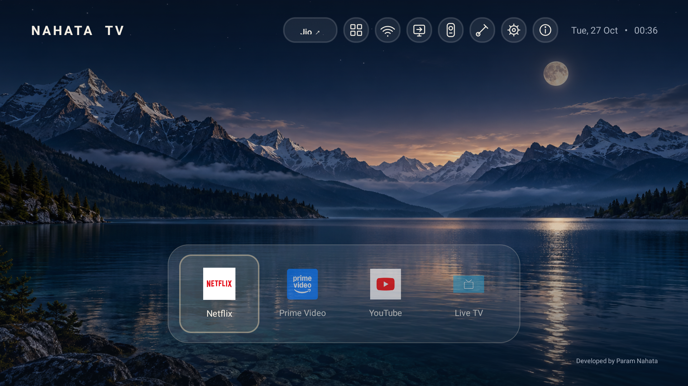
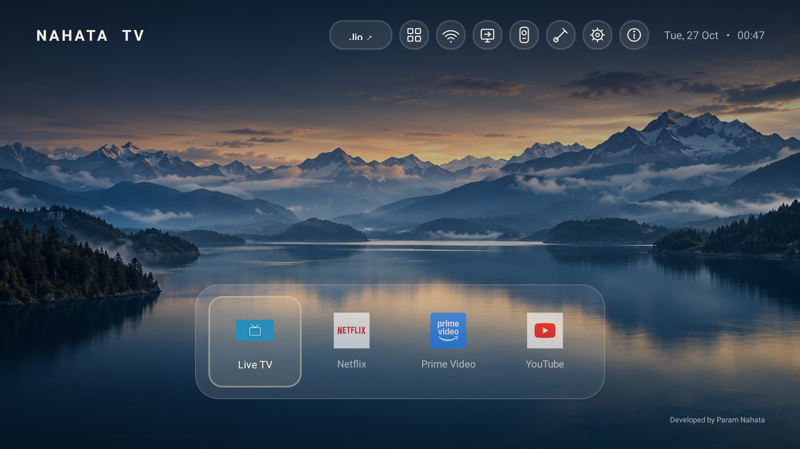
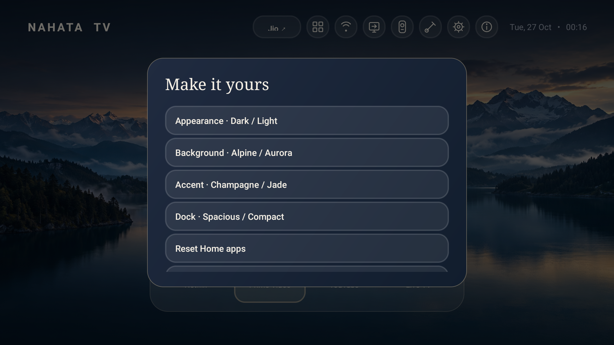

# Nahata TV

### Your screen. A quieter kind of home.

An original Android TV launcher developed by **Param Nahata** — a glass dock, calm scenery and controls that stay out of the way.

[](https://github.com/paramnahata/nahata-tv/actions/workflows/android.yml)
[](LICENSE)
[](docs/COMPATIBILITY.md)

[Download preview](https://github.com/paramnahata/nahata-tv/releases/tag/v0.5.1) · [Install & recover](docs/INSTALL.md) · [Phone remote](docs/REMOTE.md) · [Website](https://paramnahata.com)



**Development preview, not firmware.** Tested on one Hisense Android 9 TV; broader compatibility is unverified. The custom browser remote currently requires a laptop. A laptop-free native Nahata phone app is not included.

## A home with room to breathe

- One centred glass dock with a sliding focus highlight and D-pad navigation.
- Midnight Dark / Pearl Light, original day/night scenery, Sunset and Aurora backgrounds.
- Subtle ambient motion with an off switch and respect for system disabled animations.
- Netflix, Prime Video, YouTube and Live TV on Home when installed; everything else in Apps.
- Hold OK to Show/Hide on Home or Rearrange. Left/Right moves, OK saves, Back cancels.
- Compact Wi-Fi, input, remote, appearance, settings and About controls.
- User-selectable Jio input, local preferences and a small developer credit.
- No advertisements, accounts, analytics or Internet permission in the launcher.

## See it on a TV



The screenshots above are real device captures from v0.5.0. v0.5.1 preserves this appearance and adds portable input setup and clearer remote guidance.

<details>
<summary>More visuals: dialog styling and source scenery</summary>



The dialog capture illustrates the styling; current menu entries differ. The images below are bundled background assets, not screenshots of a running light-theme TV.

| Daylight scenery | Moonlit scenery |
| --- | --- |
|  |  |

Wallpaper provenance and generation prompts: [ASSETS.md](ASSETS.md).

</details>

## Get started

1. Download the APK and checksums from [Releases](https://github.com/paramnahata/nahata-tv/releases/tag/v0.5.1).
2. Install on a compatible Android TV 9+ using the TV's supported installation flow or authorised ADB. Keep the original launcher enabled.
3. Open Nahata TV from Apps, test your remote and app launching, then configure Home behaviour if your firmware permits.
4. Brush icon → Choose Jio input selects your actual HDMI port. Android TV boxes may not expose the physical television's inputs.

Full commands, APK update/signing notes and recovery: **[Install & recover](docs/INSTALL.md)**.

This APK does not run on VIDAA, Tizen or webOS. Missing streaming apps are not downloaded or bundled. App names/icons belong to their respective owners.

## Phone remote: what actually works without a laptop?

For a compatible Android TV, use the **Google TV app on Android or iPhone** with local pairing. The TV service must support it; confirm on your own device.

The included `remote/` browser UI is an optional authenticated laptop bridge. Uploading its HTML/JS to public PHP/static hosting does not remove the bridge requirement. A future original native phone client is the recommended custom direction, but is not shipped here.

Read **[Remote architecture and Hostinger limitations](docs/REMOTE.md)** before choosing a setup. No public ADB exposure is needed or recommended.

## Home, Back and the original launcher

Back at Nahata's root stays on Home; Back from Apps returns Home. System Home support varies by firmware. The optional Home override receives only window-state events from `com.google.android.tvlauncher` and cannot read screen content. Enable it only with informed consent; it is not a universal OEM-launcher override.

Personalise → Switch to original launcher pauses the override. Reopen Nahata TV to resume. To remove the override fully, disable its service in Android Accessibility settings and restore your original default Home. No stock launcher is disabled or removed.

## Build and contribute

JDK 17+, Android SDK 35; Gradle wrapper included:

```text
./gradlew assembleDebug lintDebug
python -m unittest discover -s remote -p "test_*.py"
```

Windows uses `gradlew.bat`. APK output: `app/build/outputs/apk/debug/app-debug.apk`. Development signing keys can differ between published, local and CI builds; do not mix them for upgrades. See [install/update notes](docs/INSTALL.md).

[Compatibility matrix](docs/COMPATIBILITY.md) · [Changelog](CHANGELOG.md) · [Roadmap](docs/ROADMAP.md) · [Contributing](CONTRIBUTING.md) · [Privacy](PRIVACY.md) · [Security](SECURITY.md)

Useful contributions include device reports, accessible D-pad behaviour, translations and reproducible fixes. Redact private information from reports. If Nahata TV is useful to you, a star helps others discover it.

## Author

**Developed by Param Nahata** · [paramnahata.com](https://paramnahata.com)

[MIT License](LICENSE). Original implementation; not affiliated with Google, Hisense, Projectivy or streaming providers.